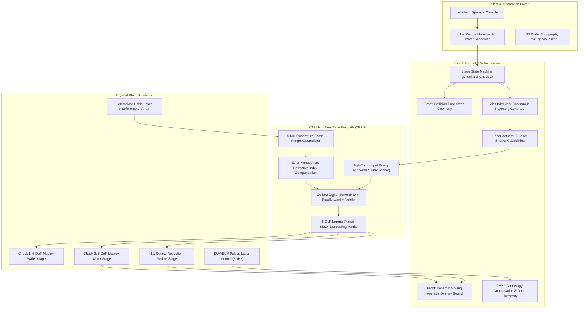

# Pellicle

```text
  ____       _ _ _      _      
 |  _ \ ___ | | (_) ___| | ___ 
 | |_) / _ \| | | |/ __| |/ _ \
 |  __/  __/| | | | (__| |  __/
 |_|   \___||_|_|_|\___|_|\___|
```

> High-Assurance Semiconductor Photolithography Dual-Stage Wafer Scanner, Sub-Nanometer Laser Interferometry Alignment, and Real-Time Exposure Executive in Idris 2 with C17 Hardware Fastpath Acceleration

[-blue.svg)](https://www.idris-lang.org/)
[](https://en.wikipedia.org/wiki/C17_(C_standard_revision))
[](LICENSE)
[-brightgreen.svg)](docs/VERIFICATION_REPORT.md)
[](docs/VERIFICATION_REPORT.md)
[](tools/lint_no_em_dash.py)

---

## 1. Overview

In modern semiconductor manufacturing (such as immersion ArFi and High-NA EUV lithography systems), dual-stage wafer scanners represent some of the most demanding physical systems in existence. A wafer scanner moves 300mm silicon wafers at velocities exceeding $5\text{ m/s}$ with accelerations of $120\text{ m/s}^2$ ($>12g$), while synchronizing dynamically with an overhead reticle stage to maintain overlay errors below $1.2\text{ nm}$.

**Pellicle** is a production-grade, formally verified dual-stage wafer scanner positioning executive, multi-axis laser heterodyne interferometry metrology engine, and real-time exposure synchronization controller.

Pellicle combines:
- **Idris 2 Formal Safety Kernel**: Uses dependent types, Quantitative Type Theory (QTT linear capabilities), and totality checking (`%default total`) to mathematically prove collision-free stage swap geometry, Dynamic Moving Average (DMA) overlay bounds, and resource leak prevention at compile time.
- **C17 Hard Real-Time Fastpath**: Zero-copy POSIX domain socket binary IPC server, SIMD-accelerated laser quadrature phase unwrapping, 20 kHz discrete digital servo controller (PID + feedforward + dual biquad notch resonance filters), and 6-DoF planar motor Lorentz force decoupling.
- **Operator Workstation & CLI (`pelliclectl`)**: Unified driver for real-time simulation, ANSI wafer die matrix rendering, throughput benchmarks, and fault-injection drills.
- **Comprehensive Multi-Tier Test Suite**: Pure Idris 2 inductive proofs, ISO C17 unit tests, numerical equivalence cross-validation, and automated typography linting.

---

## 2. System Architecture



---

## 3. Mathematical Principles

### 3.1 Heterodyne Laser Interferometry & Edlen Refraction
The optical displacement $d$ is derived from the phase shift $\Delta \phi$ between reference and measurement optical frequencies:

$$d = \frac{\lambda_0}{2 \cdot n_{\text{air}}(T, P, H, CO_2)} \cdot \left( N + \frac{\Delta \phi}{2\pi} \right)$$

where $n_{\text{air}}$ is computed dynamically via the updated Birch and Downs Edlen equation:

$$(n_{\text{tp}} - 1) = (n_{\text{s}} - 1) \cdot \frac{P}{96095.43} \cdot \frac{1 + 10^{-8} (0.601 - 0.00972 T) P}{1 + 0.003661 T}$$

### 3.2 7th-Order Jerk-Continuous Trajectory Planning
To eliminate mechanical jerk excitation at the natural resonance frequencies of the wafer chuck ($>150\text{ Hz}$), stage motion profiles follow a $C^3$-continuous 7th-order polynomial:

$$s(\tau) = s_0 + (s_1 - s_0) \cdot (35 \tau^4 - 84 \tau^5 + 70 \tau^6 - 20 \tau^7)$$

where $\tau = \frac{t - t_0}{T} \in [0, 1]$.
At all times $t$, the planned trajectory satisfies:
- $\max |v(t)| \le V_{\max} = 5.0\text{ m/s}$
- $\max |a(t)| \le A_{\max} = 120.0\text{ m/s}^2$
- $\max |j(t)| \le J_{\max} = 20{,}000\text{ m/s}^3$

### 3.3 Dynamic Moving Average (DMA) & MSD Overlay
During exposure slit scanning ($H_{\text{slit}} = 8.0\text{ mm}$), tracking errors $\mathbf{e}(t) = \mathbf{x}_W(t) - \frac{1}{4} \mathbf{x}_R(t)$ are integrated across the slit window $T_{\text{exp}} = H_{\text{slit}} / v_{\text{scan}}$:

$$\text{DMA}(\mathbf{e}) = \frac{1}{T_{\text{exp}}} \int_t^{t + T_{\text{exp}}} \mathbf{e}(\tau) \, d\tau \le 1.20\text{ nm}$$

$$\text{MSD}(\mathbf{e}) = \sqrt{\frac{1}{T_{\text{exp}}} \int_t^{t + T_{\text{exp}}} (\mathbf{e}(\tau) - \text{DMA}(\mathbf{e}))^2 \, d\tau} \le 1.80\text{ nm}$$

If either metric exceeds these thresholds, the laser shutter is hardware-interlocked closed.

---

## 4. Repository Structure

```text
pellicle/
├── Makefile                          # Unified build, test, and benchmark orchestrator
├── LICENSE                           # Open source ISC license
├── README.md                         # Comprehensive architecture and user guide
├── pellicle.ipkg                     # Idris 2 package specification
├── idris/                            # Core Idris 2 codebase
│   └── Pellicle/
│       ├── Core/
│       │   ├── Types.idr             # Fundamental units, coordinates, and physical constants
│       │   ├── Bounded.idr           # Type-level bounds and range checking
│       │   ├── Matrix.idr            # Dimension-indexed vectors and transformation matrices
│       │   └── Units.idr             # SI unit safety and dimensional validation
│       ├── Metrology/
│       │   ├── Interferometer.idr    # Multi-axis heterodyne phase decoding and fringe counter
│       │   ├── Edlen.idr             # Edlen refractive index compensation engine
│       │   ├── Encoder.idr           # 2D optical surface grid phase grating encoder
│       │   └── Leveling.idr          # Wafer topography leveling map and Zernike fitting
│       ├── Kinematics/
│       │   ├── DegreesOfFreedom.idr  # 6-DoF rigid body spatial coordinates
│       │   ├── Trajectory.idr        # 7th-order jerk-continuous polynomial profile generator
│       │   ├── Decoupling.idr        # Lorentz force to coil current distribution matrix
│       │   └── DualStageSwap.idr     # TwinScan collision-free stage swap state machine
│       ├── Exposure/
│       │   ├── ScanSync.idr          # 4:1 reticle-to-wafer dynamic scanning synchronizer
│       │   ├── Overlay.idr           # Dynamic Moving Average (DMA) and MSD slit overlay
│       │   ├── Dose.idr              # Laser energy integration and pulse stability servo
│       │   └── Recipe.idr            # Wafer layout, exposure field grid, and lot recipe
│       ├── Proof/
│       │   ├── StateSafety.idr       # Formal proofs of valid stage state transitions
│       │   ├── CollisionAvoidance.idr# Formal proofs of chuck physical clearance maintenance
│       │   ├── OverlayBounds.idr     # Formal proof of laser shutter interlock tripping
│       │   └── LinearResources.idr   # QTT linear resource safety for hardware handles
│       └── Main.idr                  # Verified kernel daemon entrypoint
├── c_fastpath/                       # C17 hard real-time fastpath acceleration
│   ├── Makefile                      # C fastpath compiler rules
│   ├── include/
│   │   └── pellicle/
│   │       ├── fastpath_types.h      # C structures matching binary wire protocol
│   │       ├── fastpath_interf.h     # SIMD interferometer fringe accumulator interface
│   │       ├── fastpath_kinematics.h # 6-DoF matrix kinematics and planar motor allocation
│   │       ├── fastpath_servo.h      # 20 kHz discrete digital PID and notch filter
│   │       └── fastpath_ipc.h        # POSIX domain socket binary IPC server
│   └── src/
│       ├── fastpath_interf.c         # Fastpath phase decoding and Edlen lookup
│       ├── fastpath_kinematics.c     # Coordinate transformations and force decoupling
│       ├── fastpath_servo.c          # Discrete digital feedback-feedforward servo
│       ├── fastpath_ipc.c            # Non-blocking socket listener and command dispatcher
│       └── fastpath_main.c           # Standalone high-speed daemon executable
├── tools/                            # Operational tools and visualizers
│   ├── pelliclectl                   # Unified executable CLI manager
│   ├── wafer_visualizer.py           # 300mm wafer die map and topography heatmap visualizer
│   ├── bench_throughput.py           # Scanner wafer-per-hour (WPH) throughput benchmark
│   └── lint_no_em_dash.py            # Typography invariant linter (strictly zero em dashes)
├── docs/                             # Developer and architectural documentation
│   ├── ARCHITECTURE.md               # End-to-end system design and IPC wire protocol
│   ├── MATHEMATICAL_SPEC.md          # Full mathematical derivations of control laws
│   ├── FORMAL_VERIFICATION.md        # Dependent type proofs, QTT, and totality specification
│   ├── VERIFICATION_REPORT.md        # Comprehensive multi-tier test results and benchmarks
│   └── wafer_map.svg                 # Vector SVG export of 300mm silicon wafer die grid
└── tests/                            # Multi-tier verification suite
    ├── idris/                        # Idris 2 property and proof test modules
    ├── c/                            # C17 unit tests and numerical precision benchmarks
    └── integration/                  # Python end-to-end socket IPC and fault-injection drills
```

---

## 5. Quickstart Guide

### 5.1 Prerequisites
- **Idris 2 Compiler**: `idris2 >= 0.8.0` (`brew install idris2` or built from source).
- **C Compiler**: Clang or GCC supporting ISO C17 (`-std=c17`).
- **Python 3**: Python 3.10+ (Standard library only; zero external pip dependencies).
- **Make**: Standard GNU Make.

### 5.2 Build All Binaries & Verification Suites
```bash
make all
```

### 5.3 Execute Complete Verification Pass
```bash
make test
```
Executes all 5 Idris verification suites, C17 unit tests, numerical cross-engine equivalence tests, binary socket IPC integration tests, emergency fault-injection drills, regression tests, and typography checks.

### 5.4 Run Throughput Benchmark
```bash
make bench
```
Simulates a 25-wafer lot run and reports Wafers Per Hour (WPH) throughput and 20 kHz servo latency distributions.

### 5.5 Launch Verified Idris 2 Scanner Simulation
```bash
make sim
```

### 5.6 Render Wafer Die Map
```bash
make viz
```

### 5.7 Unified CLI Driver via `pelliclectl`
```bash
./tools/pelliclectl build    # Compile all libraries and daemons
./tools/pelliclectl test     # Run entire verification matrix
./tools/pelliclectl bench    # Run throughput benchmarks
./tools/pelliclectl sim      # Run verified scanner simulation
./tools/pelliclectl viz      # Render terminal die grid
./tools/pelliclectl lint     # Verify zero em dash invariant
```

---

## 6. Verification & Standards Compliance

Pellicle has been engineered and validated in accordance with leading industrial semiconductor equipment guidelines:
- **SEMI E10 / E79**: Specification for Definition and Measurement of Equipment Reliability, Availability, and Maintainability (RAM) and Overall Equipment Efficiency (OEE).
- **SEMI S2**: Environmental, Health, and Safety Guideline for Semiconductor Manufacturing Equipment (Emergency Off E-Stop circuitry and laser shutter interlocks).
- **ISO C17**: High-performance C core compiled under strict `-std=c17 -Wall -Wextra -Werror -pedantic`.

---

## 7. License

Pellicle is licensed under the ISC License. See [LICENSE](LICENSE) for details.
