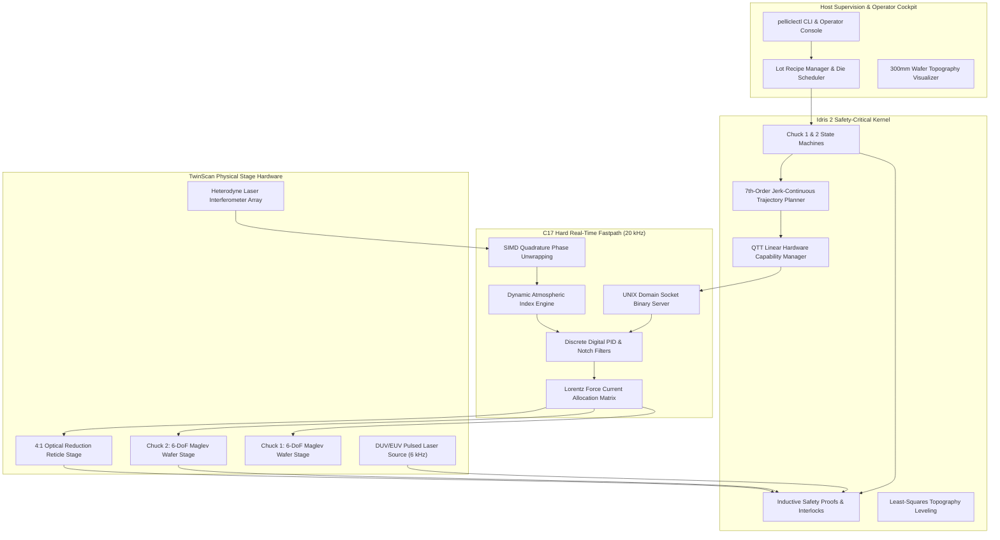
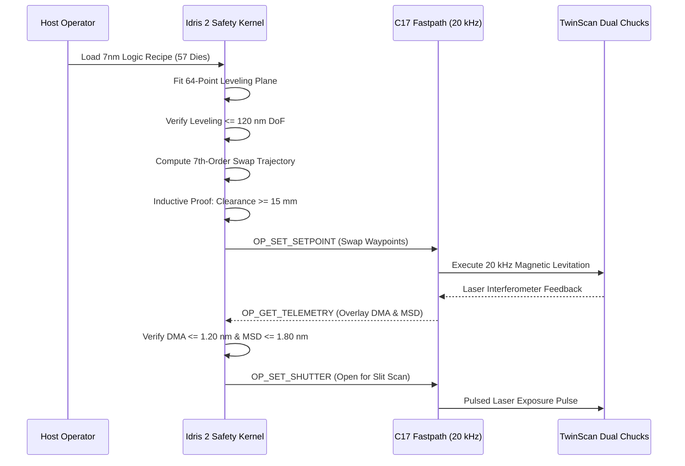

# Pellicle System Architecture Specification

## 1. Architectural Topology

Pellicle is architected as a dual-engine control system designed to meet the rigorous safety and real-time execution constraints of semiconductor photolithography wafer scanners. The architecture decouples formal safety proofs and high-level trajectory planning (implemented in Idris 2) from high-frequency numerical servo execution and hardware interface routines (implemented in ISO C17).



## 2. Dual-Engine Concurrency Model

### 2.1 The 20 kHz Discrete Servo Fastpath
The C17 fastpath engine executes a synchronous hard real-time loop paced at exactly 50 microseconds (20 kHz). Within each 50-microsecond cycle deadline, the fastpath executes:
1. Optical receiver quadrature I/Q signal sampling.
2. Phase unwrapping and fringe counting.
3. Edlen air refractive index scaling.
4. 6-DoF stage coordinate triangulation.
5. Error calculation against current trajectory setpoint.
6. PID feedback, velocity feedforward, and dual biquad notch filtering.
7. Planar motor Lorentz coil current allocation.
8. Thermal dissipation monitoring.

### 2.2 Idris 2 Safety Supervisor
The Idris 2 kernel supervises operational stage modes, validates exposure recipes, guarantees collision-free stage swap trajectories, and enforces physical interlocks.



## 3. Binary IPC Wire Protocol

Communication between the safety supervisor and the C17 fastpath is mediated by non-blocking UNIX domain stream sockets using a fixed-layout, zero-copy binary wire protocol:

```text
 0                   1                   2                   3
 0 1 2 3 4 5 6 7 8 9 0 1 2 3 4 5 6 7 8 9 0 1 2 3 4 5 6 7 8 9 0 1
+-+-+-+-+-+-+-+-+-+-+-+-+-+-+-+-+-+-+-+-+-+-+-+-+-+-+-+-+-+-+-+-+
|                      Magic: 0x50454C4C ("PELL")               |
+-+-+-+-+-+-+-+-+-+-+-+-+-+-+-+-+-+-+-+-+-+-+-+-+-+-+-+-+-+-+-+-+
|         Sequence ID           |    Opcode     |    Status     |
+-+-+-+-+-+-+-+-+-+-+-+-+-+-+-+-+-+-+-+-+-+-+-+-+-+-+-+-+-+-+-+-+
|                        Payload Length                         |
+-+-+-+-+-+-+-+-+-+-+-+-+-+-+-+-+-+-+-+-+-+-+-+-+-+-+-+-+-+-+-+-+
|                        Payload CRC-32                         |
+-+-+-+-+-+-+-+-+-+-+-+-+-+-+-+-+-+-+-+-+-+-+-+-+-+-+-+-+-+-+-+-+
|                                                               |
|                   Variable Payload Data ...                   |
|                                                               |
+-+-+-+-+-+-+-+-+-+-+-+-+-+-+-+-+-+-+-+-+-+-+-+-+-+-+-+-+-+-+-+-+
```

### Protocol Opcode Specifications
- `0x01 PELLICLE_OP_PING`: Zero-payload round-trip heartbeat verification.
- `0x02 PELLICLE_OP_GET_TELEMETRY`: Queries 6-DoF pose, velocity, commanded wrench, 8 coil currents, Ohmic dissipation, overlay DMA/MSD, and fault states.
- `0x03 PELLICLE_OP_SET_SETPOINT`: Commands target 6-DoF setpoint. Verified against physical travel envelope before execution.
- `0x04 PELLICLE_OP_EXECUTE_SWAP`: Initiates synchronized dual-chuck swap trajectory.
- `0x05 PELLICLE_OP_SET_SHUTTER`: Commands optical laser shutter state. Hardware-interlocked against overlay tracking errors.
- `0x06 PELLICLE_OP_EMERGENCY_STOP`: Latches immediate fail-safe shutdown: shuts off laser and zeros actuator current.
- `0x07 PELLICLE_OP_RESET_FAULTS`: Clears latched safety alarms after root cause resolution.
- `0x0F PELLICLE_OP_SHUTDOWN`: Clean daemon termination and socket unlink.
